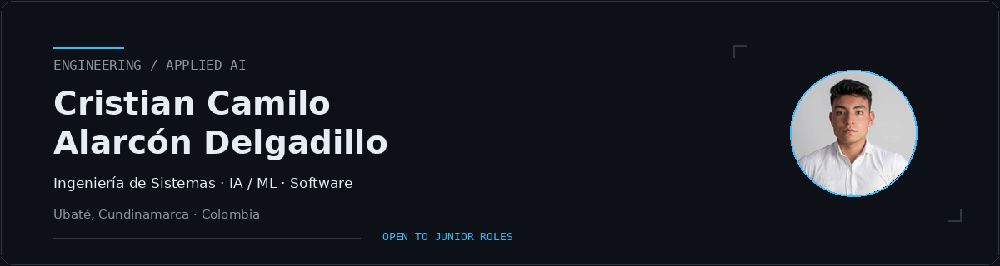

<!-- GitHub profile repository: Camilo19P8/Camilo19P8 -->
<!-- Visual system: neutral surface, cyan accent, no animated assets. -->

  <picture>
    <source media="(prefers-color-scheme: dark)" srcset="assets/banner-dark.png" />
    <source media="(prefers-color-scheme: light)" srcset="assets/banner-light.png" />
    
  </picture>

<!-- The portrait is already integrated into both 1200×320 banners. -->
<!-- Exact standalone portrait block for replacing or adapting the hero: -->
<!-- GitHub may strip inline CSS in standalone images; banners preserve the 2px border reliably. -->
<!--

-->

Construyo software y modelos de aprendizaje automático para convertir datos en información útil, con experiencia en un sistema de predicción y alertas climatológicas. Busco consolidarme como ingeniero junior en inteligencia artificial y desarrollo de software, profundizando en validación de modelos y soluciones aplicadas.

<!-- CONTACT / four informative flat-square badges -->

  
  
  <!-- Reemplaza [LINKEDIN_URL] y activa el enlace cuando tengas la URL verificada. -->
  
  

---

## 01 / Sobre mí

<!-- The degree is not presented as awarded: coursework completed. -->

Soy estudiante de Ingeniería de Sistemas y Computación de la Universidad de Cundinamarca, con el plan de estudios culminado.
Mi trabajo en un semillero de investigación (2023–2025) se centró en aplicar IA a alertas y predicción climatológica.
Participé en el diseño del sistema, entrenamiento y validación del modelo, y desarrollo del software asociado.
Me interesa el ciclo completo de los datos: preparación, modelado, evaluación e integración en productos.
Actualmente curso una especialización en Inteligencia Artificial como opción de grado.

## 02 / Stack técnico

<!-- Only tools provided by the author are listed; eight stack badges. -->

<table>
  <tr>
    <th align="left">Área</th>
    <th align="left">Tecnologías y enfoque</th>
  </tr>
  <tr>
    <td><b>Lenguajes</b></td>
    <td>
      
      
      
      
    </td>
  </tr>
  <tr>
    <td><b>Datos y bases de datos</b></td>
    <td>
      
      
       Preparación y análisis de datos
    </td>
  </tr>
  <tr>
    <td><b>IA y Machine Learning</b></td>
    <td>Entrenamiento, validación de modelos y predicción aplicada</td>
  </tr>
  <tr>
    <td><b>Herramientas</b></td>
    <td>
      
      
    </td>
  </tr>
</table>

## 03 / Proyecto destacado

<!-- Project-specific technologies must be verified before adding them. -->

<table>
  <tr>
    <td width="100%">
      <h3>Sistema de alertas y predicción climatológica con IA</h3>
      
<b>Problema.</b> Usar datos climatológicos para apoyar la predicción de condiciones y la generación de alertas.

      
<b>Mi rol.</b> Diseño del sistema, entrenamiento y validación del modelo de IA y construcción del software.

      
<b>Stack declarado.</b> Inteligencia Artificial, Machine Learning, preparación y análisis de datos, desarrollo de software. <i>[TECNOLOGÍAS EXACTAS DEL PROYECTO PENDIENTES]</i>

      
<b>Resultado.</b> Modelo entrenado y validado; trabajo presentado en ponencias y artículos. <i>[ENLACE AL REPOSITORIO / PUBLICACIONES PENDIENTE]</i>

      
<b>Qué aprendí.</b> A conectar la evaluación de un modelo con las necesidades y restricciones de un sistema real.

    </td>
  </tr>
</table>

## 04 / Actividad en GitHub

<!-- Third-party cards may be temporarily unavailable due to external rate limits. -->

  <picture>
    <source media="(prefers-color-scheme: dark)" srcset="https://github-readme-stats.vercel.app/api?username=Camilo19P8&amp;show_icons=true&amp;hide_border=true&amp;bg_color=0D1117&amp;title_color=38BDF8&amp;text_color=E6EDF3&amp;icon_color=38BDF8" />
    
  </picture>
  <picture>
    <source media="(prefers-color-scheme: dark)" srcset="https://github-readme-stats.vercel.app/api/top-langs/?username=Camilo19P8&amp;layout=compact&amp;hide_border=true&amp;bg_color=0D1117&amp;title_color=38BDF8&amp;text_color=E6EDF3" />
    
  </picture>

Estas tarjetas resumen repositorios públicos; no son una medida de competencia técnica.

## 05 / Educación y trayectoria

<!-- Compact chronological milestones; no assumed graduation date. -->

| Período | Formación / experiencia | Enfoque |
| :-- | :-- | :-- |
| Actualidad | **Universidad de Cundinamarca** · Especialización en Inteligencia Artificial, en curso | Opción de grado |
| Plan culminado | **Universidad de Cundinamarca** · Ingeniería de Sistemas y Computación | Formación en ingeniería |
| 2023–2025 | **Semillero de investigación** · Investigador / desarrollador | Predicción climatológica con IA, ponencias y artículos |
| Feb–oct 2024 | **Lácteos Ubaté** · Soporte técnico | Soporte de tecnología |

**Idiomas:** español nativo · inglés intermedio

## 06 / Contacto

<!-- Use mailto directly; there is no contact form or tracking. -->

Estoy abierto a conversar sobre oportunidades **junior en IA, Machine Learning o desarrollo de software**: **[calarcondelgadillo@gmail.com](mailto:calarcondelgadillo@gmail.com)**.

  <!-- Collapse the bilingual note to keep the Spanish summary scannable. -->
  
English summary

  I am a Systems and Computing Engineering student at Universidad de Cundinamarca, with coursework completed and an AI specialization in progress as a degree pathway.
  I worked in a research group (2023–2025) on an AI-based climate prediction and alert system, contributing to system design, model training, validation, and software development.
  My interests include applied machine learning, data preparation, and software engineering.
  I am open to junior AI and software opportunities; my English level is intermediate.

<!-- Publishing reminders: replace all [PLACEHOLDERS], verify username and project links, and inspect light/dark previews. -->
